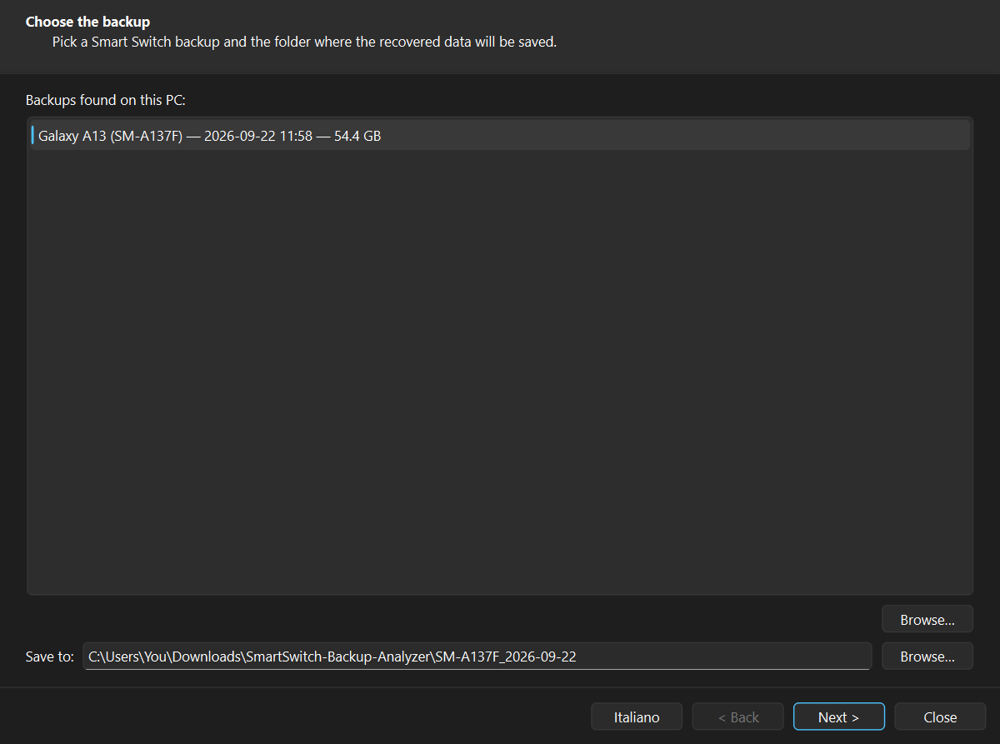
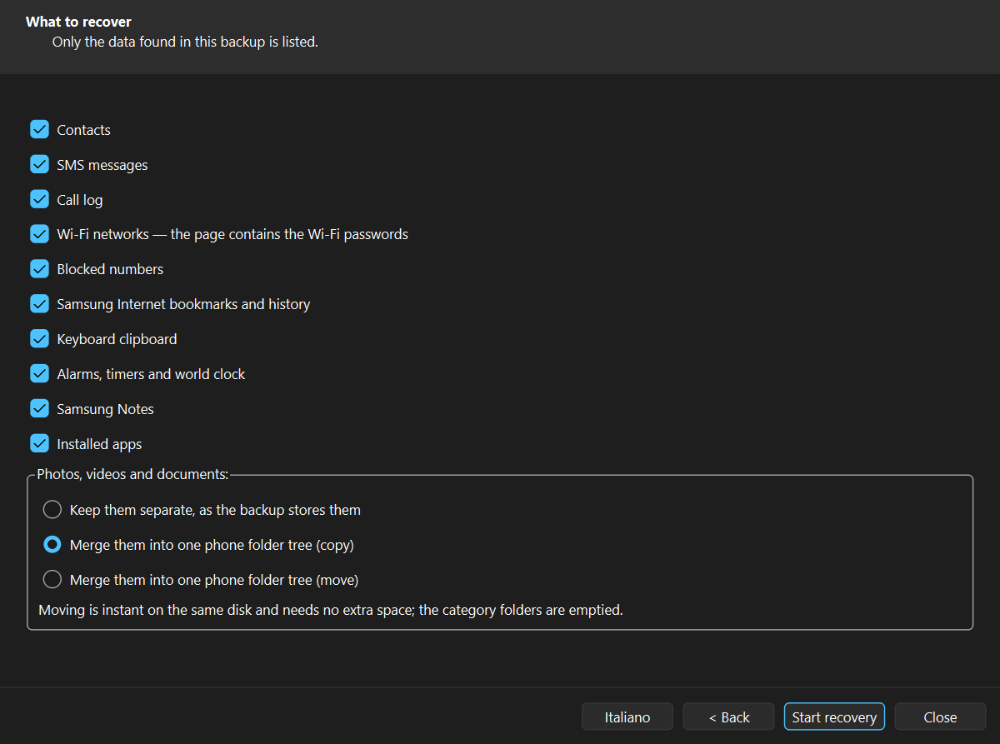
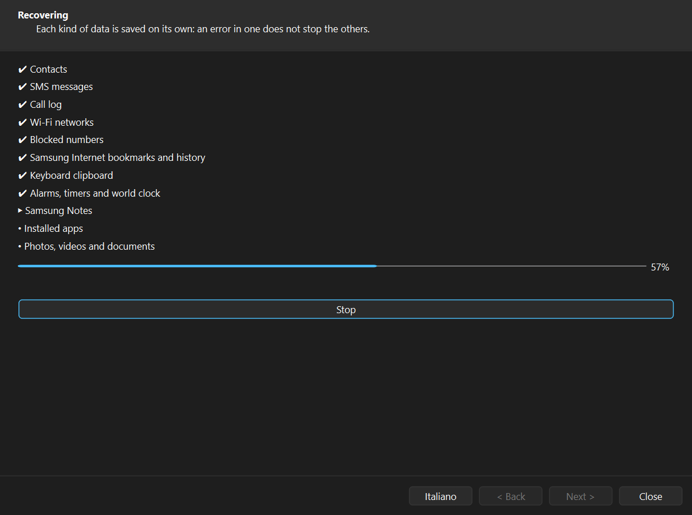
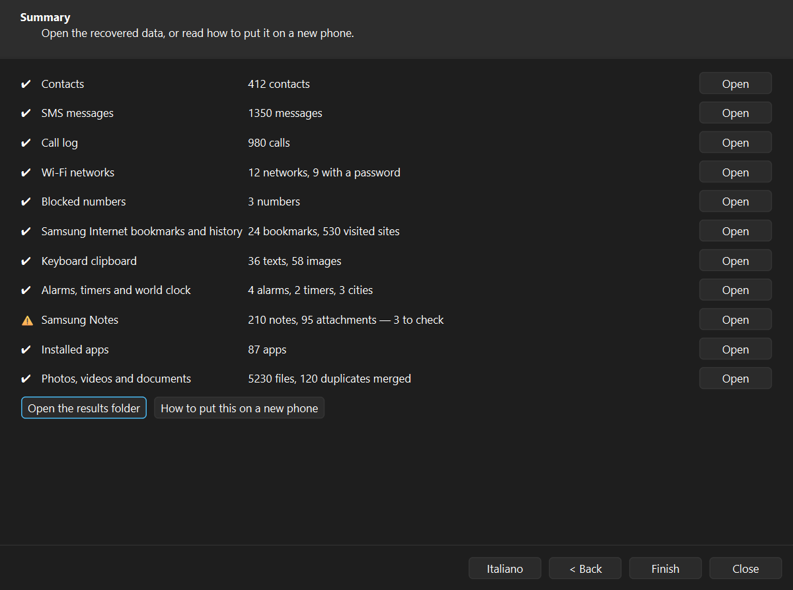

# SmartSwitch Backup Analyzer

Recover your data from a Samsung Smart Switch PC backup — even from a phone
you can no longer use (broken screen, dead device, etc.) — as long as you
still have the backup folder Smart Switch created on your PC.

## What you get back

| Data | Recovered as |
|---|---|
| Contacts | `contacts.vcf` — import into Google Contacts, iCloud, Outlook or any phone |
| SMS and call log | `sms.xml`, `calls.xml` — restore on Android with *SMS Backup & Restore* |
| Samsung Notes | one `.txt` per note, attachments (PDF, images...) side by side, folders as on the phone, deleted notes in `Trash/` |
| Photos, videos, documents, music | the phone's folder tree (`DCIM/Camera`, `Download`...) with original dates, or left in their backup folders |
| Wi-Fi networks | `wifi.html` — QR codes to connect a new phone, passwords shown only on click |
| Browser, clipboard, clock | Samsung Internet bookmarks and history, keyboard clipboard (texts and images), alarms, timers and world clock |
| Blocked numbers, installed apps | `blocked-numbers.txt`, `apps.html` with Play Store links |

## Windows: download and run

1. Download `SmartSwitch-Backup-Analyzer-<version>-windows.zip` from
   [Releases](../../releases) and **extract it** (right click → *Extract all*).
2. Open `SmartSwitch Backup Analyzer.exe`. It finds your Smart Switch backups
   by itself, decrypts the one you pick and lets you choose what to recover.
3. By default the recovered data is saved next to the program, in a folder
   named after the phone model and backup date. You can pick any other folder.

The wizard is in English and Italian (button at the bottom). Nothing is sent
anywhere: everything happens on your PC.

| 1. Pick the backup | 2. Choose what to recover |
|---|---|
|  |  |
| **3. Recovery in progress** | **4. Summary, with a button to open each result** |
|  |  |

*Screenshots from a demo backup; the numbers are invented.*

## Command line

The same folder also contains `ssba.exe`; from source, `pip install -e .`
(Python 3.10+) gives the `ssba` command.

```bash
ssba backups                                   # list the backups on this PC
ssba scan "<backup folder>" --out ./recovered  # decrypt every category
ssba export all ./recovered --out ./export     # every readable export
ssba export all ./recovered --out ./export --files copy   # also merge photos and files
```

Single exports: `ssba export contacts|messages|calls|wifi|blocked-numbers|browser|clipboard|clock|notes|apps|files`
— see `ssba export <kind> --help`. The engine is importable too
(`ssba.core`), so every step can be scripted without the interface.

The graphical interface from source: `pip install -e ".[gui]"`, then `ssba-gui`.
To build the Windows package: `.\packaging\build.ps1` (see `packaging/README.md`).

**Only "basic" Smart Switch backups (no backup password) are supported.**
Password/PIN-protected backups are not supported yet.

## How it works

Smart Switch encrypts most of a basic backup with a per-backup key that is
not published but can be recovered from `backupHistoryInfo.xml` inside the
backup. The tool derives that key, decrypts every category, then turns each
one into standard formats you can open or import elsewhere.

## Your data, your responsibility

This tool exists to recover *your own personal data*. Never commit a real
backup, or anything recovered from one, to a public Git repository. The
recovered `wifi.html` contains your Wi-Fi passwords: keep it private.
`.gitignore` already excludes `backups/`, `out/` and `output/`.

## License

AGPL-3.0 (see `LICENSE`). If you want to use this project commercially
without the obligations of the AGPL, open a GitHub issue or contact the
maintainer to discuss a commercial license.
